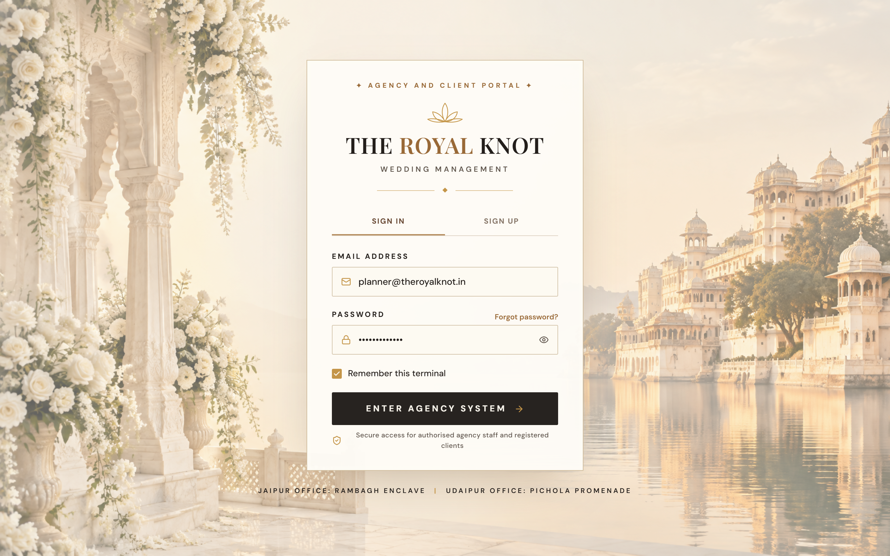
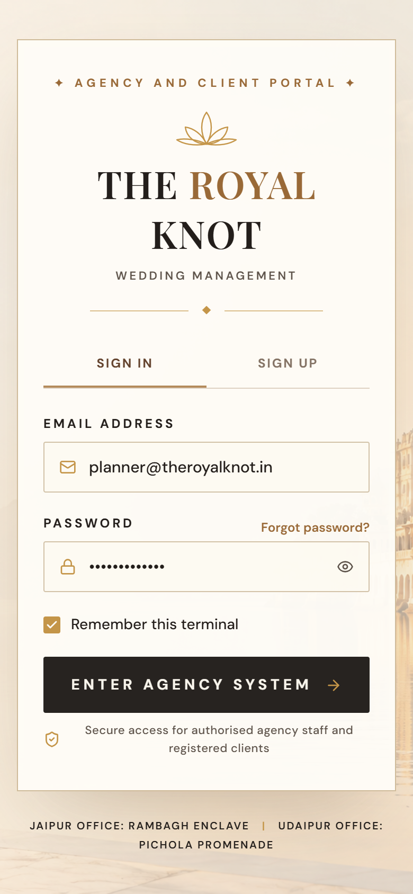
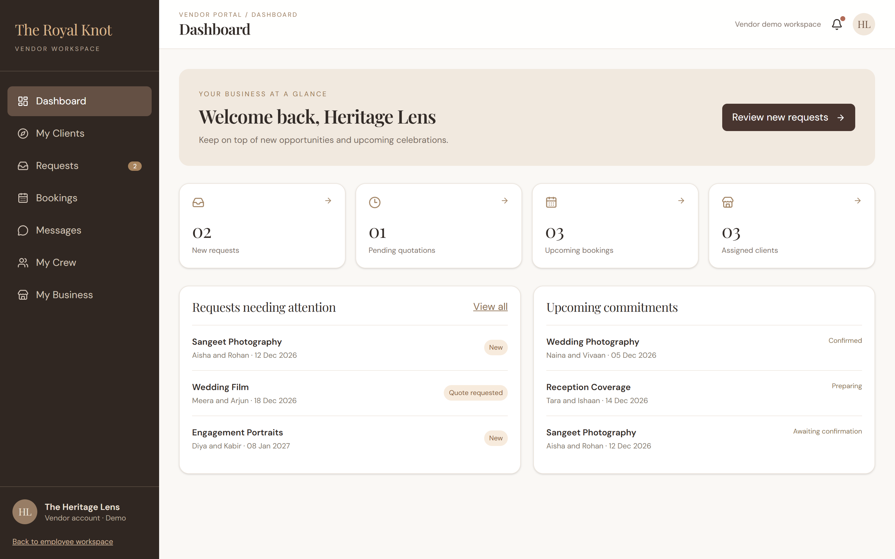
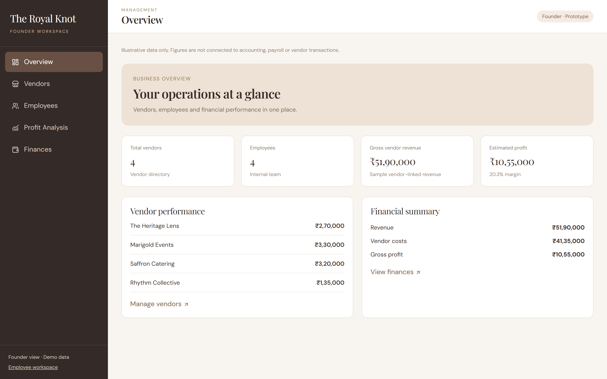

# The Royal Knot — Wedding Planning Management System
## Comprehensive User Manual for All Four Sides: Client, Employee, Vendor, and Founder

---

### Executive Overview & Philosophy
**The Royal Knot** is a bespoke, luxury wedding planning management platform built specifically for high-stakes destination weddings across Jaipur, Udaipur, and Jodhpur. Handling approximately 25 multi-crore royal celebrations per season—each spanning 3 to 4 days, 400+ distinguished guests, and 18+ luxury vendor categories—the platform coordinates all operations with cryptographic security, real-time live monitoring, and strict financial rigor.

This manual provides authoritative operational guidance for all four platform personas:
1. [**The Royal Couple (Client Portal)**](#1-client-guide--the-royal-couple)
2. [**The Wedding Planner & Team (Employee Operations)**](#2-employee-guide--wedding-planners--coordinators)
3. [**The Luxury Vendor Partner (Vendor Portal)**](#3-vendor-guide--luxury-trade-partners)
4. [**The Agency Principal (Founder & Leadership Dashboard)**](#4-founder-guide--executive-oversight--season-radar)
5. [**Not Available Yet**](#5-not-available-yet)

---

## 1. Client Guide — The Royal Couple

Welcome to your personalized royal wedding concierge. The Royal Knot protects your privacy and celebration vision while streamlining all administrative requirements.

### 1.1 Celebration Dossier Intake
Upon receiving your private invitation, you are guided through our Celebration Intake portal (`/client-intake`). Here, you register your partner details, ceremony dates, guest estimations, and royal palace preferences (e.g., Jagmandir Island, Taj Lake Palace, Umaid Bhawan Palace).

*Key Client Actions:*
- Verify partner names, contact telephone, and primary email address.
- Select your target ceremony dates across Mehendi, Sangeet, Vedic Mandap, and Reception.
- Detail royal heritage themes (e.g., "Floating Palace Splendor", "Regal Rajputana Procession").

### 1.2 Secure Agreement Signing Gateway (`/agreement`)
To protect both the couple and palace bookings, our platform enforces a strict Agreement Gate. Until the Service Agreement is digitally executed, vendor directories and operational contracts remain locked.

*Two-Factor OTP & Digital Signature Process:*
1. **One-Time Password (OTP):** Click **Send Verification Code**. An authentic 6-digit OTP is dispatched to your registered email and mobile number (10-minute validity, maximum 5 attempts).
2. **Verification:** Enter your code and click **Verify OTP**.
3. **Digital Signature Canvas:** Use your finger or stylus on mobile/tablet, or mouse on desktop, to digitally execute your signature.
4. **Execution Audit:** Check the agreement confirmation checkbox and tap **Digitally Sign Agreement**.
5. **Cryptographic Certificate:** An audit-trail PDF is generated with SHA-256 integrity hashing, timestamp, IP address, and user agent. The document is instantly archived, and all celebration planning areas unlock.

### 1.3 Client Wedding Overview (Read-Only)
Once executed, couples access their read-only Celebration Overview (`/api/v1/projects/{id}/client-overview`):
- **Ceremony Timeline:** Visual chronological view of Mehendi, Sangeet, Baraat, and Reception.
- **Planning Progress:** Task completion percentages across Venue, Design, and Catering.
- **Confirmed Luxury Vendors:** Curated directory of confirmed palace partners and contact concierges.
- **Payment Ledger:** Clear record of paid booking retainers, upcoming advances, and final balances.

---

## 2. Employee Guide — Wedding Planners & Coordinators

Agency staff oversee the complete operational lifecycle from initial enquiry to final reconciliation.

### 2.1 Enquiry Intake & Qualification (`/enquiries`)
All inbound prospective couples arriving via email, direct website intake, or Google Forms appear in the central Enquiries Workspace (`/enquiries`).

*Operational Steps:*
- Review requested celebration dates, estimated guest counts, and multi-crore budgets.
- Assign lead planners (e.g., Maharani Gayatri Singh, Raghav Sharma).
- Advance lifecycle status from `Enquiry Received` through `Registration Document Sent` to `Confirmed`.

### 2.2 Operational Weddings Portfolio (`/weddings`)
The core workspace lists all active destination celebrations across Rajasthan.

*Key Information Monitored:*
- Project Code (e.g., `PRJ-2027-HERO`, `PRJ-2026-LIVE`).
- Hub Location (Taj Lake Palace Udaipur, Rambagh Palace Jaipur, Umaid Bhawan Jodhpur).
- Current Operational Stage (`Planning`, `Execution`, `Completed`).
- Booking Deposit Status (`Paid` / `Pending`).

### 2.3 Deposit Payment & 28-Task Plan Generation
When the client booking deposit (25% retainer) is recorded:
1. Navigate to the project details and tap **Mark Deposit Paid** (`POST /api/v1/projects/{id}/deposit-paid`).
2. **Automated Plan Generation:** The system generates 28 specialized tasks (for Full-Service) or 25 tasks (for Partial) covering:
   - **Venue:** Palace permits, heritage authority NOCs, guest suite block allocations.
   - **Design & Florals:** Mandap structural engineering, royal fabrics, floral fragrance schemes.
   - **Catering:** Silver-platter degustation menus, royal thali tastings, late-night chaat counters.
   - **Ceremonies:** Mehendi artists, Sangeet choreography, Baraat elephants/vintage fleet, Vedic Pheras.
3. **Payment Milestones:** Automatically establishes 3 contractual payment stages:
   - **Stage 1 (Retainer):** 25% marked Paid upon deposit.
   - **Stage 2 (Advance):** 40% due exactly 30 days prior to wedding date.
   - **Stage 3 (Final Balance):** 35% due 3 days post-event.
4. **Idempotency Guarantee:** Re-triggering the deposit payment action will never duplicate tasks or milestones.

### 2.4 Caterer RFQ & Side-by-Side Quotation Comparison
For food and beverage planning, the agency dispatches RFQs to multiple luxury caterers:
1. Open the function catering module (`/api/v1/projects/{id}/functions/{func_id}/catering`).
2. Dispatch RFQs to multiple vendors (e.g., Mewar Royal Caterers, Rajputana Feasts, Udaipur Heritage Kitchen).
3. Review submitted bids via **Side-by-Side Compare** (`GET /api/v1/catering/{id}/quotations/compare`).
   - Normalizes food pricing, equipment charges, and 18% GST into a true **Price-per-Plate**.
   - Automatically highlights the lowest cost per plate.
4. **Atomic Winner Selection:** Selecting the winning caterer executes an atomic database transaction that:
   - Transitions winning quote to `Accepted`.
   - Transitions competing quotes to `Closed`.
   - Binds the winning caterer to `project_vendors` with locked contract pricing.

### 2.5 Big Day Live Coordinator Schedule (`/weddings/:id/big-day`)
On celebration day, ground coordinators manage the event timeline with live 30-second polling and real-time late detection.

*Live Timeline Features:*
- **Real-Time Dynamic Late Engine:** An event is dynamically flagged **LATE** whenever current wall-clock time exceeds `expected_arrival_time + grace_period_minutes` and vendor has not arrived.
- **One-Tap Check-In:** When vendor enters the palace gate, tap **Check-In**. Arrival timestamp is stamped, and late alert clears immediately.
- **Mobile-First Layout:** Designed for coordinators moving through palace corridors with filter pills (`All`, `Pending`, `Arrived`, `Late`).

### 2.6 Settlement Extras & Idempotent Vendor Payouts
During and after the wedding, operational adjustments are captured cleanly:
1. **Logging Extras:** Record extra plates or overtime (e.g., 60 Extra Gala Dinner Plates, DJ 2 Hours Overtime). Extras are flagged for client invoicing.
2. **Vendor Payout Computation:**
   $$\text{Final Payout} = \text{Agreed Contract Amount} + \text{Approved Extras} - \text{Advances Deducted}$$
3. **Idempotency Key:** Payouts are generated with strict uniqueness keys (`PAYOUT-{project_id}-{vendor_id}`). Submitting a duplicate payout request is rejected with HTTP 409 Conflict.

---

## 3. Vendor Guide — Luxury Trade Partners

The Royal Knot Vendor Portal (`/vendor-portal`) allows catering chefs, decor designers, musicians, and fleet operators to collaborate transparently.

### 3.1 Authentication
Vendor representatives sign in using their registered trade email, phone number, or authorized contact person name.

### 3.2 Reviewing Assigned Celebrations & RFQs
Once authenticated, the dashboard displays:
- **Assigned Weddings:** Celebrations where your firm is contracted.
- **Incoming RFQs:** Requests for quotations with guest counts, service styles, and dietary parameters.
- **Contract Performance:** Scorecards displaying ratings, on-time arrivals, and total contract volume.

### 3.3 Submitting Itemized Quotations
Vendors submit itemized quotes with clear breakdowns:
- Base per-person rate (food cost).
- Royal service style (Silver Platter, Royal Buffet, Live Stations).
- Ancillary equipment and logistics fees.
- Applicable GST taxes (5% or 18%).
- Itemized menu courses (Shahi Starters, Main Course, Royal Desserts).

### 3.4 Status Progression
- `Received` $\rightarrow$ Submitted and logged in agency review queue.
- `Under Review` $\rightarrow$ Under evaluation alongside competing proposals.
- `Accepted` $\rightarrow$ Winning bid selected; contract binding.
- `Closed` $\rightarrow$ Competing proposal closed gracefully for the function.

---

## 4. Founder Guide — Executive Oversight & Season Radar

The Founder Portal (`/founder-portal`) equips agency leadership with season-wide portfolio control and financial governance.

### 4.1 Season Financial Dashboard
Aggregates performance across the entire 25-wedding season:
- **Total Client Contracted Value:** Aggregate bookings value across Rajasthan.
- **Realized Cash Receipts:** Total booking retainers and stage advances banked.
- **Contracted Vendor Outflows:** Committed costs across palace venues, decor, catering, and production.
- **Internal Team Labor Burden:** Total planner and coordinator hours multiplied by hourly billing rates.
- **Founder Net Profit & Margin:** Clear net gross margin across all active and completed celebrations.

### 4.2 Four-Week Cash Flow Radar
Anticipates liquidity and upcoming dues over the next 28 days:
- Identifies client milestone payments coming due.
- Tracks vendor advance commitments before palace deadlines.
- Highlights days remaining to prevent calendar bottlenecks.

### 4.3 Vendor Reliability Scorecards
Ranks catering, decor, entertainment, and logistics partners based on:
- Punctuality rating on live Big Day check-ins.
- Quotation competitiveness and billing accuracy.
- Execution excellence across palace banquets.

### 4.4 Per-Wedding Profitability Engine
Calculates true gross profitability per wedding celebration:
$$\text{Founder Gross Profit} = \text{Client Payments Received} - \text{Vendor Costs} - \text{Team Labor Costs}$$
*Sample Hand-Calculated Benchmark (Aarav & Meera Hero Wedding):*
- Client Payments Received: ₹3,54,00,000.00
- Vendor Contracted Costs: ₹2,02,75,000.00
- Team Labor Costs (310 hours): ₹18,00,000.00
- **Founder Gross Profit:** **₹1,33,25,000.00**
- **Gross Profit Margin:** **37.64%**

### 4.5 Shareable Expiring Executive Reports
To brief investors, royal family patrons, or co-founders:
- Tap **Generate Executive Report Link** (`GET /api/v1/founder/season-overview/export?token={token}`).
- Produces a secure, expiring tokenized HTML dossier rendering executive charts and cash flow metrics without exposing internal administrative access.

---

## 5. Not Available Yet

The following items are planned for future seasonal roadmaps and are currently unavailable:
- **Multi-Currency International Forex Client Wires:** Direct cross-border credit card or automated currency hedging (currently transactions are natively managed in INR).
- **Autonomous Drone Video Direct Ingest Feed:** Live video streaming from wedding drones directly into the Big Day coordinator dashboard.
- **Biometric Fingerprint Kiosks:** Hardware biometric scanning for palace service staff check-in (currently handled via coordinator mobile check-in buttons).
